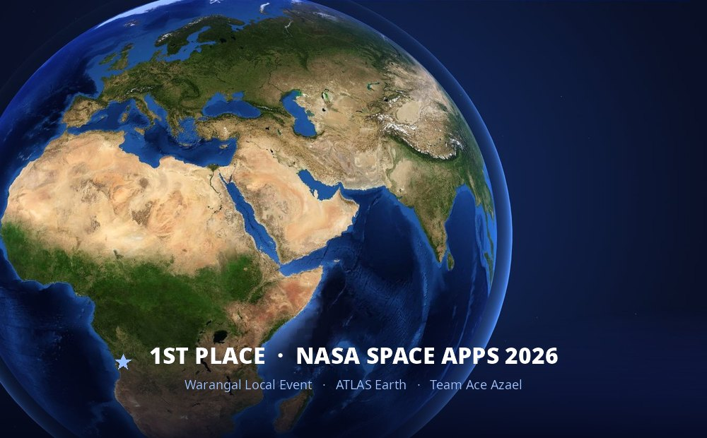
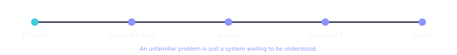

# Chavan Srikar

<picture>
  <source media="(min-width: 769px) and (prefers-color-scheme: light)" srcset="assets/hero-light-desktop.svg" />
  <source media="(max-width: 768px) and (prefers-color-scheme: light)" srcset="assets/hero-light-mobile.svg" />
  <source media="(max-width: 768px) and (prefers-color-scheme: dark)" srcset="assets/hero-dark-mobile.svg" />
  
</picture>

  
  
  

  
  
  

---

## 🛰️ Featured — NASA Space Apps Challenge 2026

<a href="https://atlas-ace-azael.vercel.app/" target="_blank" rel="noopener noreferrer">
<picture>
  <source media="(min-width: 769px)" srcset="assets/atlas-globe-desktop.webp" type="image/webp" />
  <source media="(max-width: 768px)" srcset="assets/atlas-globe-mobile.webp" type="image/webp" />
  
</picture>
</a>

  🏆 <b>1st place · Warangal local event</b> — the actual ATLAS Earth globe, built from NASA POWER and GIBS data with Team Ace Azael. Click the image to explore the live app.

  <a href="https://atlas-ace-azael.vercel.app/" target="_blank" rel="noopener noreferrer">🌍 Live demo</a>
  ·
  <a href="https://github.com/chavansrikar/Be-An-Earth-System-Trend-Detective-Team-Ace-Azael" target="_blank" rel="noopener noreferrer">Source code</a>

---

## 🧠 Professional summary

I'm a **software engineer and AI systems builder** who takes ambiguous, real-world problems all the way to working software. I start by understanding the domain and the people affected, break the challenge into tractable parts, choose the right tools for each part, and then ship something that holds up against real data and real users.

The thread running through every project below is the same: **find the actual bottleneck, design the system around it, and validate the outcome against the problem — not against a demo.** I care about the unglamorous parts that make software dependable: data quality, preprocessing, service boundaries, state machines, failure modes, testing and deployment.

My work spans clinical-adjacent gait analysis for prosthetic users, district-level healthcare operations, satellite climate-trend detection for NASA, privacy-first DeFi risk analysis, developer tooling, and production websites for real clients. I move comfortably between **Python / AI-ML** and **TypeScript / modern web**, which lets me own a problem from the model layer to the interface a person actually touches.

> 🛰️ **Recent recognition:** 1st place at the **NASA Space Apps Challenge 2026**, Warangal local event, for **ATLAS Earth** — a full-stack trend-detective built on 30 years of NASA data.
>
> 🎓 **Foundation:** AI & ML diploma → lateral-entry B.Tech CSE at ACE Engineering College (TG ECET rank 1965), deliberately adding hardware, architecture and systems depth on top of the model layer.

---

## 🔧 How I approach an unfamiliar problem

<picture>
  <source media="(min-width: 769px) and (prefers-color-scheme: light)" srcset="assets/loop-light-desktop.svg" />
  <source media="(max-width: 768px) and (prefers-color-scheme: light)" srcset="assets/loop-light-mobile.svg" />
  <source media="(max-width: 768px) and (prefers-color-scheme: dark)" srcset="assets/loop-dark-mobile.svg" />
  
</picture>

1. **Frame it** — understand the real stakeholder, constraints, edge cases and what "done" actually means.
2. **Decompose it** — split the messy challenge into independent, testable pieces with clear interfaces.
3. **Build it** — implement the smallest complete version, then strengthen data handling, model quality and UX.
4. **Validate it** — check results against real data, statistical tests and failure scenarios — not just the happy path.
5. **Ship it** — deploy it where someone else can use it, then iterate from their feedback.

This is how a hard, interconnected problem becomes a system someone can rely on.

---

## 🛠️ Tech stack & tools

**Languages:** Python · TypeScript · JavaScript · Java · SQL · C/C++ (basics)

<b>AI / ML / Computer Vision</b> — click to expand

  
  
  
  
  
  
  
  
  
  
  
  
  

<b>Frontend & modern web</b> — click to expand

  
  
  
  
  
  
  
  
  
  
  

<b>Backend, data & platform</b> — click to expand

  
  
  
  
  
  
  
  
  
  
  
  
  
  

---

## 🚀 Selected work

Every project here started as a real problem with constraints — not a tutorial.

### 🛰️ ATLAS Earth — Be An Earth System Trend Detective 🏆

**NASA Space Apps Challenge 2026 · 1st place, Warangal local event · Team Ace Azael**
<a href="https://github.com/chavansrikar/Be-An-Earth-System-Trend-Detective-Team-Ace-Azael" target="_blank" rel="noopener noreferrer">Source</a> · <a href="https://atlas-ace-azael.vercel.app/" target="_blank" rel="noopener noreferrer">Live demo</a>

NASA climate data is open but hard to read. ATLAS turns 30 years of it into an answer a person can act on: pick a variable and a place, then get the trend, a significance test, a NASA imagery view and a plain-language explanation. It tests **25 NASA POWER variables** at once with Benjamini–Hochberg correction, maps trends grid cell by cell, compares up to six places, and renders a NASA Blue Marble / photoreal 3D globe with monthly GIBS overlays. Streamflow from USGS/ECCC gauges is clearly labelled as supplementary, and nothing is fabricated when data is missing. Default finding: Amazon Basin air temperature **+0.32 °C/decade, p ≈ 0.007**.

`TypeScript` · `React` · `Three.js` · `NASA POWER / GIBS / EONET` · `Vercel`

### 🦿 NGPME — Next-Gen Prosthetic Mobility Enhancer

<a href="https://github.com/chavansrikar/NGPME_major_project" target="_blank" rel="noopener noreferrer">Source</a> · <a href="https://huggingface.co/spaces/srikarrr/NGPME_major_project" target="_blank" rel="noopener noreferrer">Live demo</a>

Prosthetic users and clinicians normally need an expensive motion-capture lab to assess gait and fall risk. This system extracts 33 pose landmarks from an ordinary smartphone video with MediaPipe, derives 18+ biomechanical metrics, then combines an **LSTM classifier** and an **Isolation Forest** anomaly detector into a single fall-risk score — with an annotated video and charts as output. Built during a six-month industrial training programme, inspired by my father's need for something genuinely useful.

`Python` · `Gradio` · `MediaPipe` · `OpenCV` · `TensorFlow/Keras` · `scikit-learn` · `SQLite` · `ffmpeg`

### 🏥 Bharat Health Detective Care

<a href="https://github.com/chavansrikar/Bharat-Health-Detective-Care" target="_blank" rel="noopener noreferrer">Source</a>

Public-health capacity is usually invisible — facilities, workforce, screening and referrals sit in silos. This is an integrated operations picture with **17 screens** across those domains, a consent-led citizen portal and 8 role-based workspaces. It's engineered properly: Gradio 5 over a strict service layer and SQLAlchemy 2 ORM (no SQL in UI callbacks), a referral state machine with urgency safety rules, 12 CSV exports and a deterministic demo reset.

`Python` · `Gradio 5` · `SQLAlchemy` · `SQLite` · `Pydantic` · `Plotly`

### 🌿 Dr. Shalini's Homoeopathy

<a href="https://github.com/chavansrikar/Dr_shalini" target="_blank" rel="noopener noreferrer">Source</a> · <a href="https://www.drshalinis.com" target="_blank" rel="noopener noreferrer">Live site</a>

A production rebuild of a real clinic's website, not a demo. The practice owner needed a fast modern site and a way to publish articles without calling a developer — so it ships with an embedded Sanity Studio at `/admin`. Next.js 15 App Router, strict TypeScript, Tailwind CSS 4, Framer Motion, react-hook-form + Zod and Vercel deployment.

`Next.js 15` · `TypeScript` · `Tailwind v4` · `Sanity CMS` · `Framer Motion`

### ✨ Animated Developer Portfolio

<a href="https://github.com/chavansrikar/portfolio" target="_blank" rel="noopener noreferrer">Source</a> · <a href="https://chavansrikar.github.io/portfolio/" target="_blank" rel="noopener noreferrer">Live site</a>

A React 19 + TypeScript portfolio built from public GitHub and LinkedIn data, with a custom 5×6 block-font ASCII engine, glyph-scrambling skill tiles and an ASCII photo portrait — animated with anime.js v4 and Framer Motion, smooth-scrolled with Lenis, styled with Tailwind v4 and deployed through GitHub Actions. Mobile-first, accessible, and the design reference for this profile README.

`React 19` · `TypeScript` · `Vite 8` · `Tailwind v4` · `anime.js v4` · `Framer Motion` · `Lenis`

### 🛡️ Nostromo Guard — AI-Powered DeFi Risk Optimizer

<a href="https://github.com/chavansrikar/Nostromo-Guard-AI-Powered-DeFi-Risk-Optimizer" target="_blank" rel="noopener noreferrer">Source</a>

A privacy-first, fully local pre-flight audit for DeFi smart contracts. A custom heuristic engine scans for reentrancy, `tx.origin` phishing and unchecked external calls to produce a 0–100 risk score, while a Monte-Carlo random walk simulates 30-day TVL and flags liquidity crunches. No contract code ever leaves the machine.

`Python` · `Gradio` · `Heuristics` · `Monte Carlo` · `Matplotlib`

---

## 📦 More applied work

| Project | The problem it tackles | Stack |
|---|---|---|
| <a href="https://github.com/chavansrikar/crowd-density-prevention" target="_blank" rel="noopener noreferrer">👥 Crowd Density & Stampede Prevention</a> | Real-time people detection and density alerts before a crowd crosses unsafe thresholds | Python · Streamlit · YOLOv8 · OpenCV |
| <a href="https://github.com/chavansrikar/project-on-voice-assistant" target="_blank" rel="noopener noreferrer">🎙️ Omnix Voice Assistant</a> · <a href="https://project-on-voice-assistant-060.onrender.com/" target="_blank" rel="noopener noreferrer">demo</a> | Two-way speech recognition + synthesis in the browser; I led a team of 6 | JavaScript · Node.js · Express |
| <a href="https://github.com/chavansrikar/Automated-Wheat-Disease-Detection" target="_blank" rel="noopener noreferrer">🌾 Automated Wheat Disease Detection</a> | Wheat-leaf photo in, disease classification out — for farmers who need answers fast | Python · Deep Learning · Gradio |
| <a href="https://github.com/chavansrikar/universal-error-explainer-tool" target="_blank" rel="noopener noreferrer">🐞 Universal Error Explainer</a> | Cryptic stack traces across six languages explained in plain language | Python · Web |
| <a href="https://github.com/chavansrikar/Tools-For-Hackathon" target="_blank" rel="noopener noreferrer">🧰 Tools-For-Hackathon</a> | A curated 35+ tool kit for moving from pitch to deployed product under pressure | Markdown · Open Source |

<b>Complete public repo index — all 21 repositories</b> — click to expand

| Repository | Description | Language | ★ |
|---|---|---|---|
| <a href="https://github.com/chavansrikar/Be-An-Earth-System-Trend-Detective-Team-Ace-Azael" target="_blank" rel="noopener noreferrer">Be-An-Earth-System-Trend-Detective-Team-Ace-Azael</a> | ATLAS Earth — NASA Space Apps 2026 trend detective | TypeScript | 4 |
| <a href="https://github.com/chavansrikar/portfolio" target="_blank" rel="noopener noreferrer">portfolio</a> | Animated ASCII-motion portfolio site | TypeScript | 0 |
| <a href="https://github.com/chavansrikar/Bharat-Health-Detective-Care" target="_blank" rel="noopener noreferrer">Bharat-Health-Detective-Care</a> | District healthcare operations platform | Python | 0 |
| <a href="https://github.com/chavansrikar/java-lab" target="_blank" rel="noopener noreferrer">java-lab</a> | Java lab programs and experiments | Java | 1 |
| <a href="https://github.com/chavansrikar/Dr_shalini" target="_blank" rel="noopener noreferrer">Dr_shalini</a> | Clinic website with embedded Sanity Studio | TypeScript | 0 |
| <a href="https://github.com/chavansrikar/Tools-For-Hackathon" target="_blank" rel="noopener noreferrer">Tools-For-Hackathon</a> | 35+ tools for building under a deadline | — | 4 |
| <a href="https://github.com/chavansrikar/nexus" target="_blank" rel="noopener noreferrer">nexus</a> | Experiments and scratch work | — | 0 |
| <a href="https://github.com/chavansrikar/chavansrikar" target="_blank" rel="noopener noreferrer">chavansrikar</a> | This profile README repository | — | 0 |
| <a href="https://github.com/chavansrikar/vighnaraja" target="_blank" rel="noopener noreferrer">vighnaraja</a> | Gradio / Hugging Face Space configuration | Python | 0 |
| <a href="https://github.com/chavansrikar/my-project" target="_blank" rel="noopener noreferrer">my-project</a> | Early Python experiments | Python | 0 |
| <a href="https://github.com/chavansrikar/sticker-sheet-generator" target="_blank" rel="noopener noreferrer">sticker-sheet-generator</a> | Printable sticker/label sheet utility | Python | 0 |
| <a href="https://github.com/chavansrikar/python-dsa-journey" target="_blank" rel="noopener noreferrer">python-dsa-journey</a> | Personal Data Structures & Algorithms practice | Python | 0 |
| <a href="https://github.com/chavansrikar/Automated-Wheat-Disease-Detection" target="_blank" rel="noopener noreferrer">Automated-Wheat-Disease-Detection</a> | Deep-learning crop disease classifier | Python | 0 |
| <a href="https://github.com/chavansrikar/RoadSafe-Analytics-Road-Accidents-Exploratory" target="_blank" rel="noopener noreferrer">RoadSafe-Analytics-Road-Accidents-Exploratory</a> | EDA on road-accident data | Python | 0 |
| <a href="https://github.com/chavansrikar/Nostromo-Guard-AI-Powered-DeFi-Risk-Optimizer" target="_blank" rel="noopener noreferrer">Nostromo-Guard-AI-Powered-DeFi-Risk-Optimizer</a> | Offline smart-contract risk auditor | Python | 0 |
| <a href="https://github.com/chavansrikar/NGPME_major_project" target="_blank" rel="noopener noreferrer">NGPME_major_project</a> | Video-based gait analysis and fall-risk scoring | Python | 0 |
| <a href="https://github.com/chavansrikar/universal-error-explainer-tool" target="_blank" rel="noopener noreferrer">universal-error-explainer-tool</a> | Plain-language programming error explanations | Python | 2 |
| <a href="https://github.com/chavansrikar/python-fullstack-snippets" target="_blank" rel="noopener noreferrer">python-fullstack-snippets</a> | Reusable Python full-stack snippets | Python | 2 |
| <a href="https://github.com/chavansrikar/project-on-voice-assistant" target="_blank" rel="noopener noreferrer">project-on-voice-assistant</a> | Omnix — browser voice assistant | JavaScript | 1 |
| <a href="https://github.com/chavansrikar/recommendation_system-for-movies" target="_blank" rel="noopener noreferrer">recommendation_system-for-movies</a> | Recommender-system experiments | — | 1 |
| <a href="https://github.com/chavansrikar/crowd-density-prevention" target="_blank" rel="noopener noreferrer">crowd-density-prevention</a> | YOLOv8 crowd density and alerts | Python | 1 |

---

## 📊 GitHub at a glance

<picture>
  <source media="(prefers-color-scheme: light)" srcset="https://github-readme-stats.vercel.app/api?username=chavansrikar&amp;show_icons=true&amp;theme=default&amp;count_private=true" />
  
</picture>
<picture>
  <source media="(prefers-color-scheme: light)" srcset="https://streak-stats.demolab.com/?user=chavansrikar&amp;theme=default" />
  
</picture>

<picture>
  <source media="(prefers-color-scheme: light)" srcset="https://github-readme-stats.vercel.app/api/top-langs/?username=chavansrikar&amp;layout=compact&amp;theme=default" />
  
</picture>
<picture>
  <source media="(prefers-color-scheme: light)" srcset="https://github-readme-activity-graph.vercel.app/graph?username=chavansrikar&amp;theme=default&amp;hide_border=true" />
  
</picture>

---

## 🎓 Journey & highlights

| When | Milestone |
|---|---|
| **2026 — Present** | B.Tech CSE (lateral entry), ACE Engineering College — TG ECET rank 1965 |
| **Nov 2026** | 🏆 **1st place**, NASA Space Apps Challenge 2026 — Warangal local event (ATLAS Earth) |
| **2023 — 2026** | AI & ML Diploma, Samskruti College, Ghatkesar — 8.21 CGPA |
| **2025 — 2026** | Infosys Springboard virtual internship — 17+ AI/ML certification tracks |
| **2025** | Centum Foundation × Infosys — 60-hour employability training; SkillUp selectee |
| **2025 — 2026** | Google for Developers program · VBYLD 2026 state-level participant · My Bharat Budget Quest |
| **2025** | Omnix Voice Assistant — team lead of 6 at the Diploma project expo |

---

## 📫 Let's connect

Open to internships, collaborations on AI/CV systems, or any problem that needs a careful engineer and a working solution. Every link below opens in a new tab so you can keep this profile open.

  
  
  
  
  
  

---

  <b>About this profile:</b> the two animated SVGs live inside this repo (<code>assets/</code>), so no third-party service or cache can break them. They ship in light/dark and desktop/mobile variants chosen with <code>&lt;picture&gt;</code> media queries, and every link opens in a new tab. Design references: <a href="https://www.gitskins.com/blog/best-github-readme-animations" target="_blank" rel="noopener noreferrer">GitSkins — tasteful README animations</a> and <a href="https://dev.to/grahamthedev/take-your-github-readme-to-the-next-level-responsive-and-light-and-dark-modes--3kpc" target="_blank" rel="noopener noreferrer">DEV — responsive READMEs with light and dark modes</a>.

